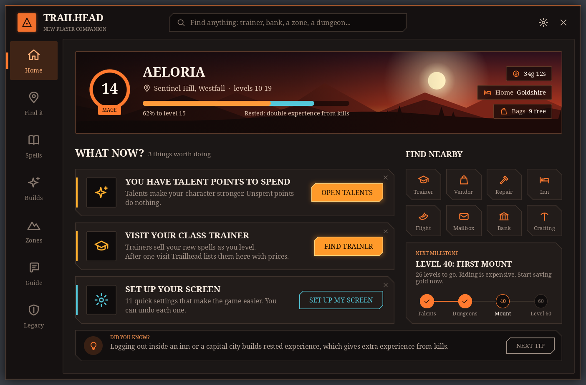
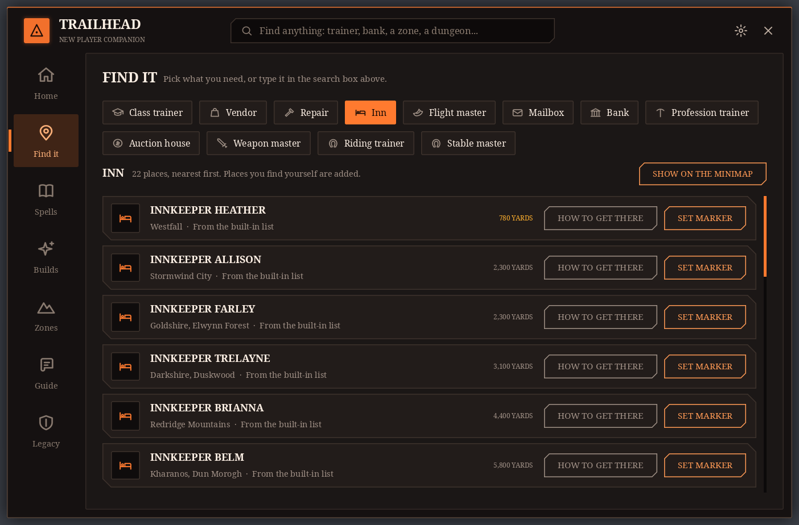
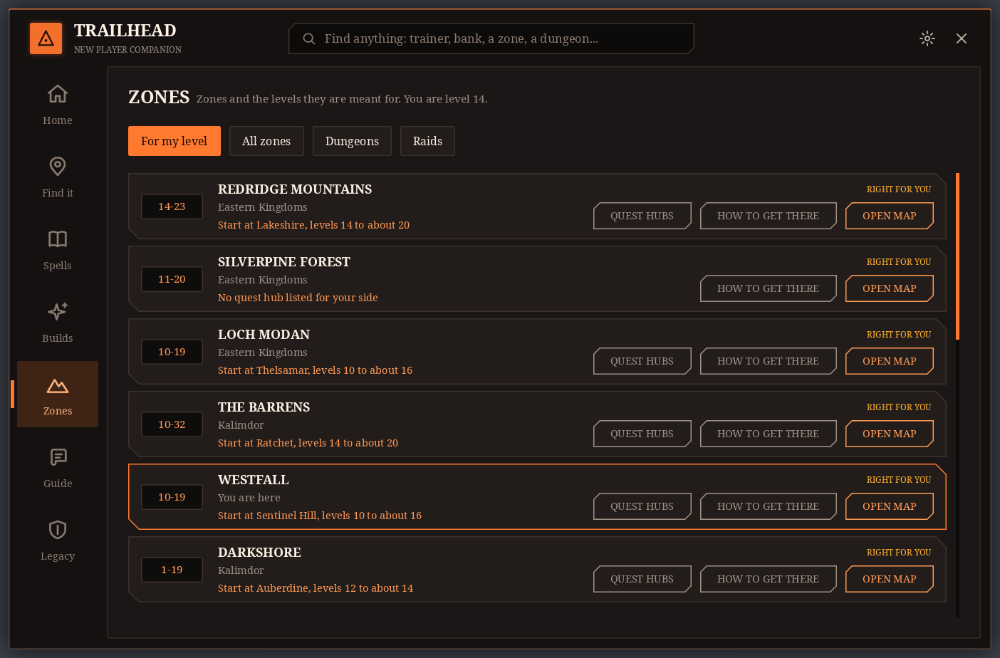
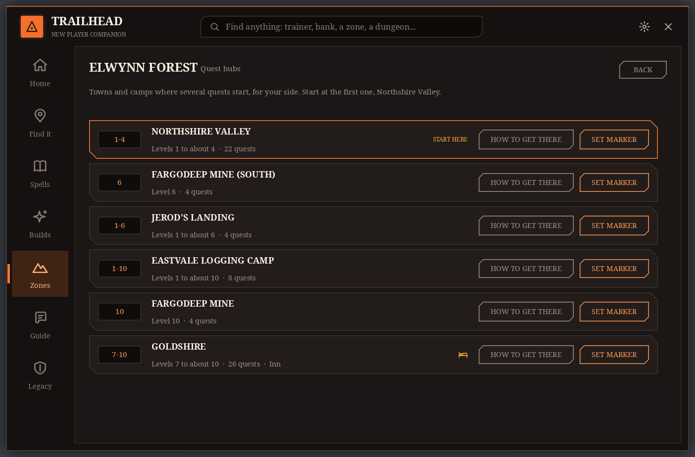
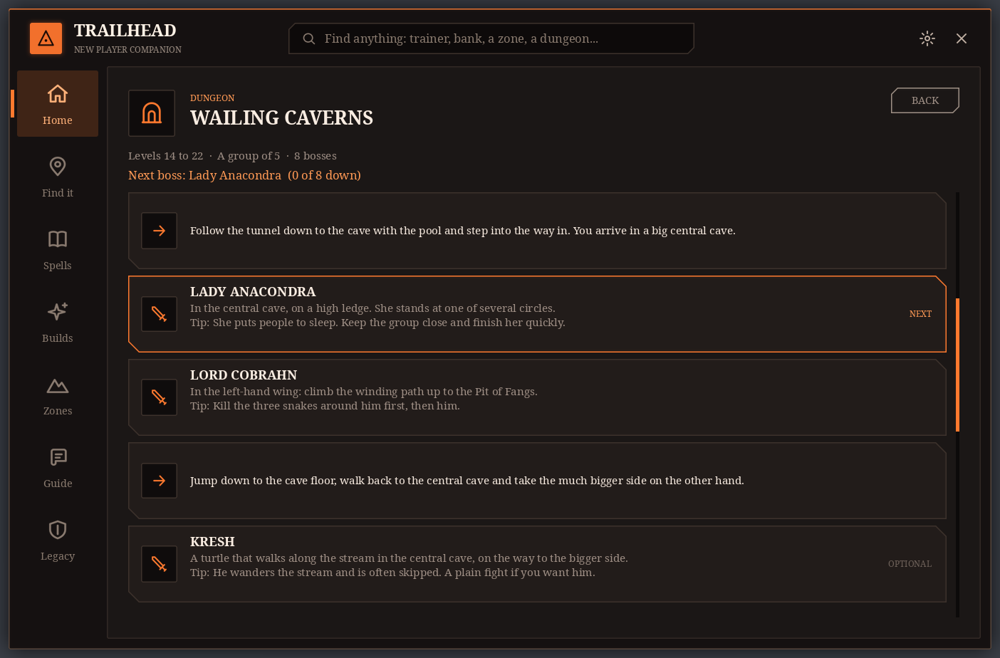
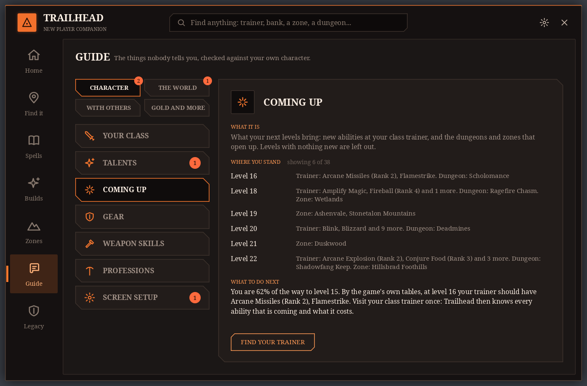
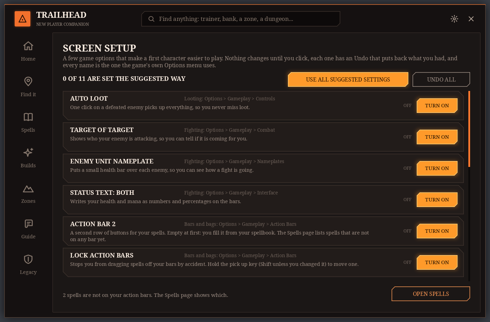
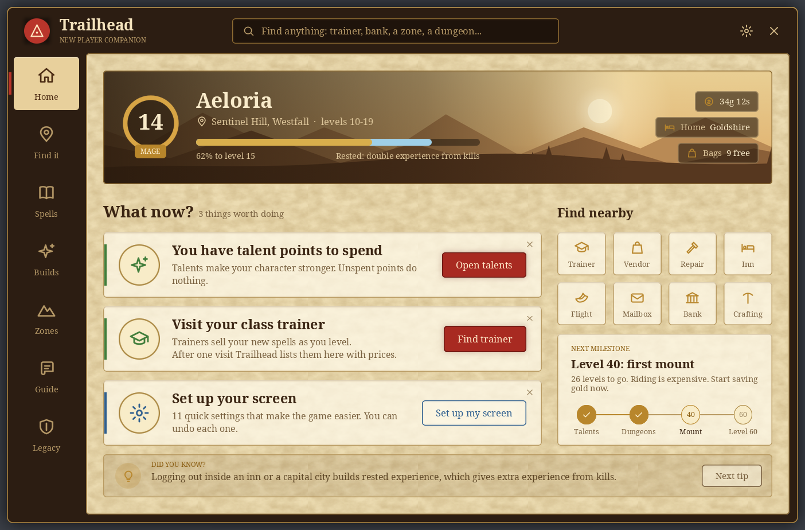
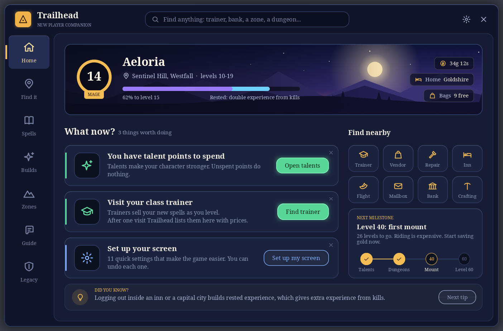

# Trailhead

**The new player companion for World of Warcraft: Forever.** It tells you what to do next, shows where trainers, vendors, banks and dungeons are, explains the parts of the game nobody tells you about, and helps with spells, talents and gear on the road to level 60.

## Download

**[Download Trailhead.zip (latest version)](https://github.com/pl0xuee/Trailhead/releases/latest/download/Trailhead.zip)**

1. Download the zip with the link above.
2. Unpack it. You get one folder called `Trailhead`.
3. Move that folder into `World of Warcraft/_forever_/Interface/AddOns/`.
4. Start the game, or type `/reload` if it is already running. Type `/th` to open Trailhead.

Trailhead needs no other addon. It is made for Forever (game version 1.60.1). Older versions and release notes are on the [releases page](https://github.com/pl0xuee/Trailhead/releases) and in the [changelog](CHANGELOG.md).

## Pictures

| | |
|---|---|
|  **Find it.** About 1,800 places ship inside the addon, listed closest first. |  **Zones.** What fits your level and where your side starts. |
|  **Quest hubs.** Where the quests are in each zone, in order. |  **Dungeon routes.** The way through, boss by boss. |
|  **Guide.** Short topics, checked against your own character. |  **Screen setup.** Helpful game options, one click each, one click to undo. |
|  **Journal look.** |  **Night look.** |

Three looks come with it: Ember (above), Journal and Night.

These pictures are drawn outside the game by the project's own layout tool (`tools/layout_review.py`), from the addon's code and artwork with a test character. In the game the letters are the game's own fonts, so the text looks a little different.

## What it does

- **Home**: advice cards for the thing that matters now (spells to train, talent points to spend, damaged gear, full bags, a dungeon that fits your level).
- **Find it**: search for any service, zone, quest hub or dungeon, with "How to get there" steps. About 1,800 places ship inside the addon, so it works on a brand-new character; places you find yourself are added on top.
- **Zones**: which zones fit your level, where your side starts in each, and its quest hubs.
- **Dungeon routes**: for every dungeon and raid, the way through, each boss, where it stands and a tip. Inside a dungeon the page follows along.
- **Spells and Builds**: what your trainer teaches, which spells are not on your bars, and ready-made talent builds for every class to follow. Trailhead never spends a point for you.
- **Guide**: short topics on how the game works, and what the next levels bring.
- **Screen setup**: recommended interface settings for a first character, one click each, one click to undo.
- **Legacy**: your Legacy Points, how to earn them, and what they unlock.
- **At vendors**: the game has its own Sell All Junk and Repair buttons. Trailhead can sell grey junk and repair by itself when a vendor window opens, if you turn that on in Settings, and can add a second pair of buttons that show the price first. Both are off by default.

## Commands

| Command | What it does |
|---|---|
| `/th` | open or close Trailhead |
| `/th settings` | open the settings |
| `/th theme night`, `journal`, `ember` | change the look |
| `/th find bank` | search for a place, a zone or a dungeon |
| `/th clear` | remove the map marker |
| `/th check` | run the game check (what your game can tell Trailhead) |
| `/th reset` | move the window back to the middle |

You can also use the minimap button, the addon menu under the minimap, or a key binding (Options, Key Bindings, Trailhead).

## Privacy

Trailhead sends nothing anywhere. It has no network access, no accounts and no tracking. It only reads what your game shows it and saves its own settings and the places you have found in the game's normal saved-variables files on your computer.

## For translators

Every text shown to players goes through `L["English text"]`; English is the key. To make a translation:

1. Run `python3 tools/gen_locale_keys.py --lua deDE > Trailhead/Locales/deDE.lua` (use your locale code).
2. Fill in the right-hand sides. A line left empty keeps the English text.
3. Add `Locales\deDE.lua` to `Trailhead/Trailhead.toc` straight after `Locales\enUS.lua`.

`python3 tools/gen_locale_keys.py` alone prints the plain list of keys.

## For developers

`tools/check.sh` runs the offline syntax check and test suite (Lua 5.1). `tools/layout_review.py` draws every page in all three looks outside the game and reports text that is cut, overlapping or off the page. `tools/package.sh` builds `dist/Trailhead-<version>.zip`. Publishing a GitHub release sends it to CurseForge (`.github/workflows/curseforge.yml`). `.pkgmeta` is for the CurseForge and Wago packager.

Trailhead is under the MIT licence (`LICENSE`). The data files are generated by `tools/gen_*.py` from the game's own tables and from MIT-licensed location data; notices are in `Trailhead/THIRD-PARTY-LICENSES.txt`.
